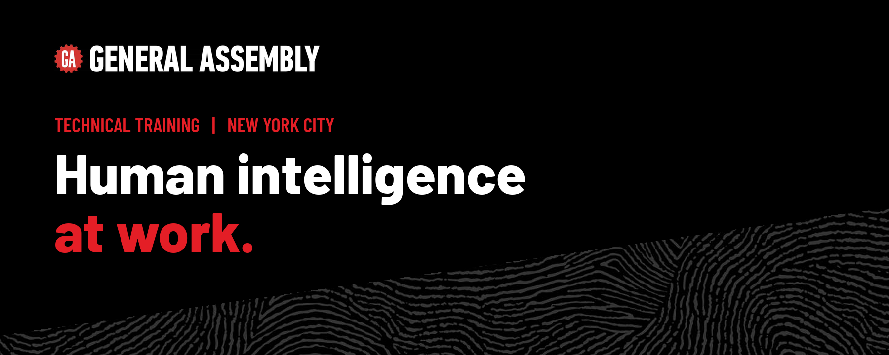
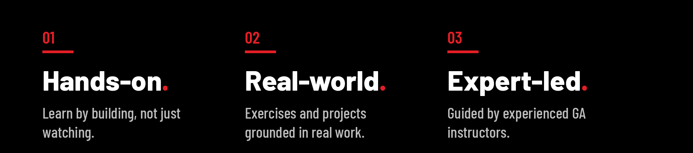

  

## Welcome

This is a General Assembly organization. It hosts repositories, course materials, and project work from one of our technical training programs.

  

## About General Assembly

General Assembly helps people and organizations build in-demand skills in technology, data, AI, and more. Our programs are built around learning by doing: hands-on, practical, and taught by people who do the work.

[Learn more at helloga.com →](https://www.helloga.com/)

 

  

